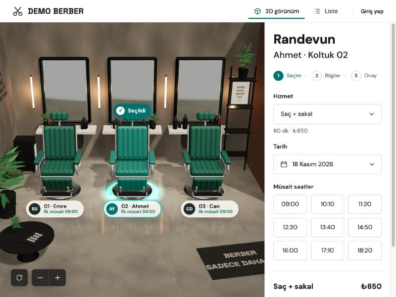
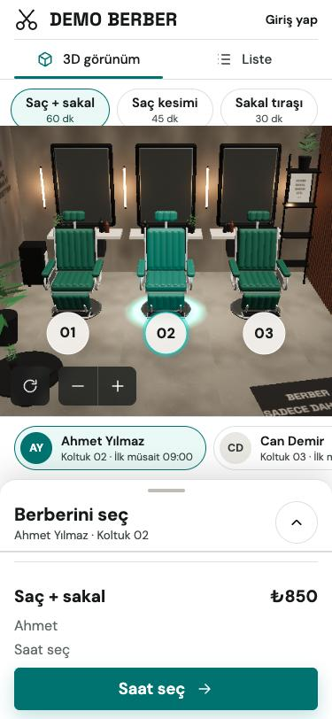
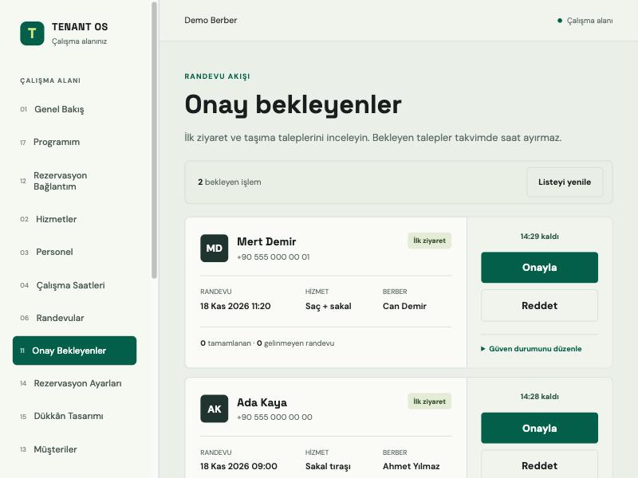
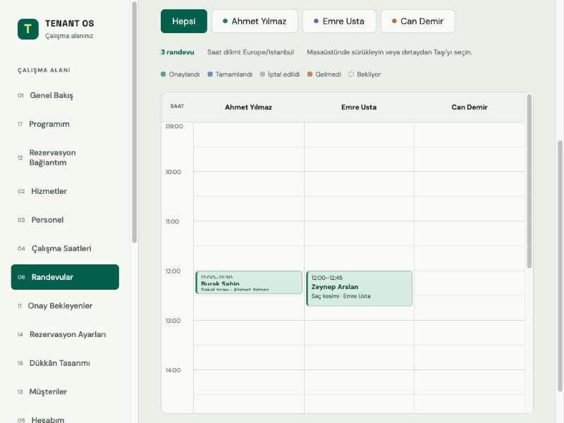
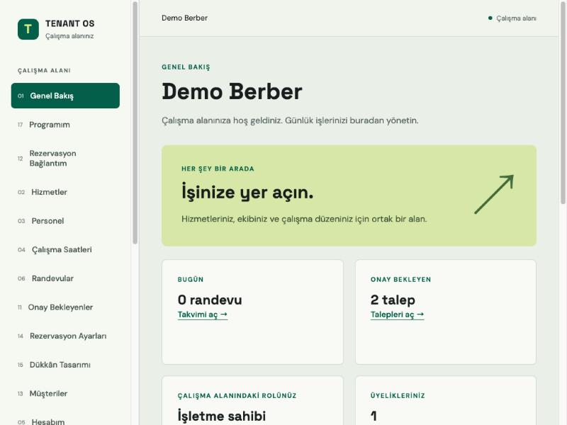

# Multi-tenant Barber Booking SaaS

[](https://github.com/emirhan-coban/multi-tenant-saas/actions/workflows/ci.yml)


A multi-tenant appointment platform for independent barbers. Customers pick a chair in an
interactive **3D shop** and book a slot; shop owners approve requests, manage staff, services and
working hours, and see reports. Turkish UI, English code-level docs below
([Türkçe özet](README.tr.md)).

**Live demo:** https://multi-tenant-saas.emirhancob4n.workers.dev/book/demo-berber
· **API health:** https://saas-backend-ms03.onrender.com/api/health

> The demo runs on free tiers (Cloudflare Workers, Render, Supabase, Upstash). The backend sleeps
> after 15 minutes of inactivity, so the **first request can take 30-60 seconds**. Demo data is
> fake and reset periodically; please do not enter real personal data.

<p align="center">
  
  &nbsp;
  
</p>
### Owner panel

<table>
  <tr>
    <td width="50%"><br><sub><b>Approval queue</b>: first-time customers wait for owner/manager review</sub></td>
    <td width="50%"><br><sub><b>Calendar</b>: per-staff day/week view with drag-to-reschedule</sub></td>
  </tr>
  <tr>
    <td colspan="2"><br><sub><b>Dashboard</b>: role-based navigation (OWNER / MANAGER / STAFF)</sub></td>
  </tr>
</table>


**Try it:** open the live link above, pick a chair in the 3D shop, choose a service and a slot.
Owner and staff panel (`/login`) demo accounts are listed in
[`docs/deploy-free.md`](docs/deploy-free.md#5-demo-verisi).

## Highlights

- **Tenant isolation enforced in the database.** PostgreSQL Row Level Security with a
  non-superuser `saas_app` role; the tenant is derived from the access token and set per
  connection (`TenantAwareDataSource`). Integration tests run against a real Postgres as the
  restricted role, so RLS is exercised by every test.
- **Race-safe booking.** Row locks, idempotency keys and version-checked reschedule/cancel keep
  double-booking out under concurrency.
- **Trust-based approval flow.** First-time customers go to an owner/manager approval queue; after
  a verified first visit a customer becomes `TRUSTED` and later bookings auto-confirm (policy and
  limits are per tenant).
- **Versioned 3D shop (Three.js / react-three-fiber).** Draft, publish and rollback of shop scenes,
  chair-to-staff mapping, list/3D switch that keeps the booking draft.
- **Production-minded operations.** Transactional outbox with ShedLock, Redis/Bucket4j rate limiting,
  immutable audit log, plan quotas, KVKK/GDPR export and deletion, PWA with Web Push, Prometheus
  metrics behind a token.
- **Two separate identity systems** (staff vs. customers), each with access/refresh tokens and
  session versioning.
- **Quality gates.** 170+ backend and 120+ frontend tests, 34 Flyway migrations, CI matrix over two
  time zones, production image builds and a compose smoke test.

## Architecture

```
 Browser / PWA ── nginx ── React 19 + Vite SPA (TanStack Query, Three.js)
                     │
                     └──► Spring Boot 4 (Java 21) ── PostgreSQL 16 (RLS, Flyway)
                                   │
                                   └──────────────► Redis (rate limits, shared counters)
```

| Area | Where |
| --- | --- |
| Backend modules | `backend/src/main/java/com/saas/backend/{auth,booking,appointment,customer,billing,...}` |
| Migrations | `backend/src/main/resources/db/migration` |
| Web client | `web/src` (`api/`, `query/`, `router/`, `screens/`) |
| Ops, deploy, backups | `ops/` |
| Design notes per phase (Turkish) | `docs/` — start with [`development-notes.tr.md`](docs/development-notes.tr.md) |
| API contract | [`docs/contracts/booking-v1.openapi.yaml`](docs/contracts/booking-v1.openapi.yaml) |

## Tech stack

| Layer | Technology |
| --- | --- |
| Backend | Java 21, Spring Boot 4, Spring Security (JWT), JPA/Hibernate, Flyway, Bucket4j, ShedLock |
| Data | PostgreSQL 16 with Row Level Security, Redis (rate limits, shared counters) |
| Web | React 19, Vite, TypeScript, TanStack Query, React Router 7, Three.js / react-three-fiber |
| Quality | JUnit 5 + Testcontainers (real Postgres/Redis), Vitest + Testing Library, GitHub Actions |
| Ops | Docker, nginx, Prometheus metrics, Web Push (VAPID), PWA, KVKK/GDPR export & deletion |
| Hosting (demo) | Cloudflare Workers (static assets), Render, Supabase, Upstash: all free tiers |

## Engineering notes

- **RLS needs care at the edges.** Pre-login flows have no tenant context, so reading a `tenants`
  row under RLS fails unless the context is set inside the transaction. This bit the first live
  deploy (login returned a masked 401) and is now covered by a real-HTTP regression test
  (`StaffLoginTenantContextTests`), because the older tests did not exercise that path.
- **Why a restricted DB role matters.** Tests and production both connect as `saas_app`
  (`NOSUPERUSER NOBYPASSRLS`); a superuser connection would silently bypass every policy.
- **Session pooling.** Tenant context is session state, so Supabase's *session* pooler (port 5432)
  is required; the transaction pooler (6543) would break isolation.
- **Fail-closed rate limiting.** If Redis is unreachable, auth endpoints refuse requests instead of
  skipping the limit (`RATE_LIMIT_UNAVAILABLE`), and the cause is logged.
- Per-phase design notes (Turkish) live in [`docs/`](docs/development-notes.tr.md).

## Known limitations

- Free-tier hosting means cold starts (see the note above) and Supabase pauses idle projects after
  7 days; a scheduled workflow (`.github/workflows/keepalive.yml`) pings the API to prevent that.
- The public demo runs with e-mail delivery disabled and billing in demo mode (no real payments).
  Production mode (`APP_SECURITY_DEV_SECRETS_ALLOWED=false`) requires live Gmail credentials and
  real secrets; see [`docs/deploy-free.md`](docs/deploy-free.md#bilinçli-demo-ödünleri).
- The UI is Turkish only.

## Run locally

Requires Docker.

```bash
cp .env.example .env
docker compose --profile app up -d
# Frontend: http://localhost:5173/app   Backend health: http://localhost:8081/api/health
```

Tests:

```bash
./backend/mvnw -f backend/pom.xml test     # Testcontainers: needs Docker
cd web && npm ci && npm test && npm run build
```

## Deploying on free tiers

Supabase (Postgres) + Upstash (Redis) + Cloudflare Pages (frontend) + a free container host for the
backend. Step-by-step: [`docs/deploy-free.md`](docs/deploy-free.md) and
[`docs/cloud-database.md`](docs/cloud-database.md).

## License

[MIT](LICENSE)
