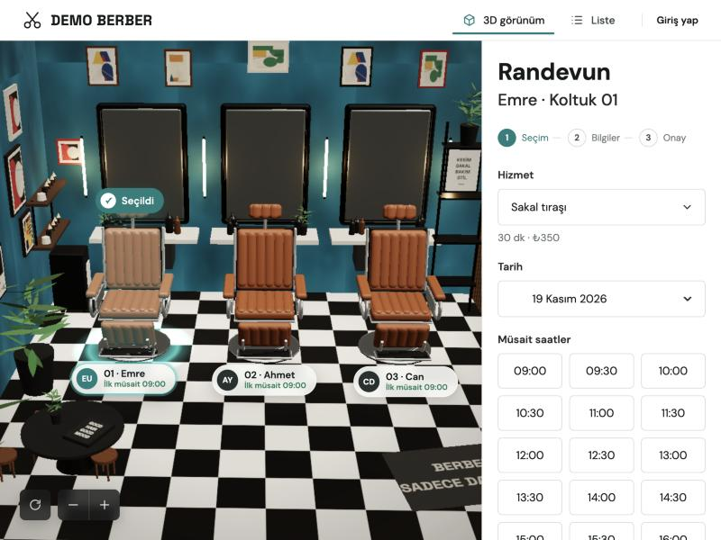

# Çok Kiracılı Berber Randevu SaaS'ı

[English README](README.md)

Bağımsız berberler için çok kiracılı randevu platformu. Müşteri 3D dükkanda koltuk seçip randevu
talep eder; işletme sahibi talepleri onaylar, personel/hizmet/çalışma saatlerini yönetir ve
raporları görür.

**Canlı demo:** https://multi-tenant-saas.emirhancob4n.workers.dev/book/demo-berber (ücretsiz katmanda çalışır; ilk istek 30-60 sn sürebilir)

**Öne çıkanlar:** PostgreSQL Row Level Security ile veritabanı seviyesinde tenant izolasyonu,
yarış koşullarına karşı güvenli rezervasyon (kilit + idempotency), güvenilir müşteri için otomatik
onay, sürümlü 3D dükkan sahneleri, transactional outbox, rate limit, KVKK dışa aktarma/silme, PWA +
Web Push, Testcontainers ile gerçek PostgreSQL üzerinde testler.

- Demo giriş (sahip): `demo@berber.test` / `Demo1234`, personel: `ahmet@berber.test` / `Demo1234`
- Yerelde çalıştırma: `cp .env.example .env && docker compose --profile app up -d`
- Faz faz geliştirme notları: [docs/development-notes.tr.md](docs/development-notes.tr.md)
- Ücretsiz yayın rehberi: [docs/deploy-free.md](docs/deploy-free.md)
- Lisans: [MIT](LICENSE)
