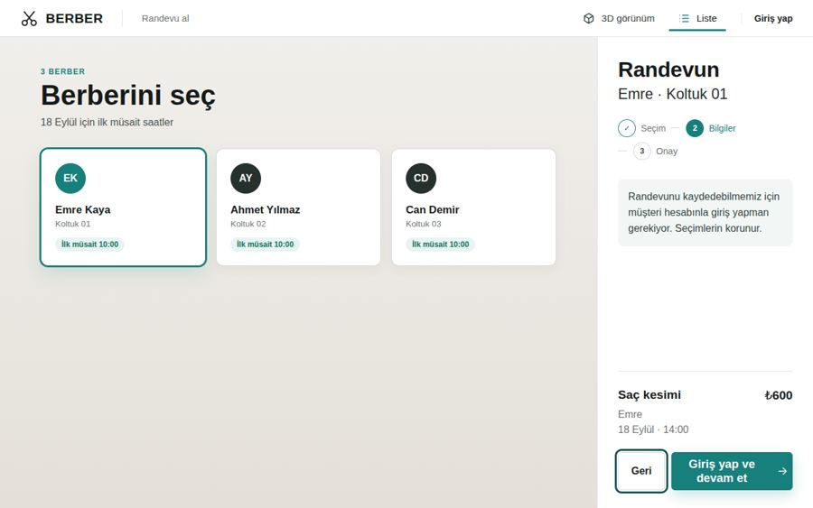
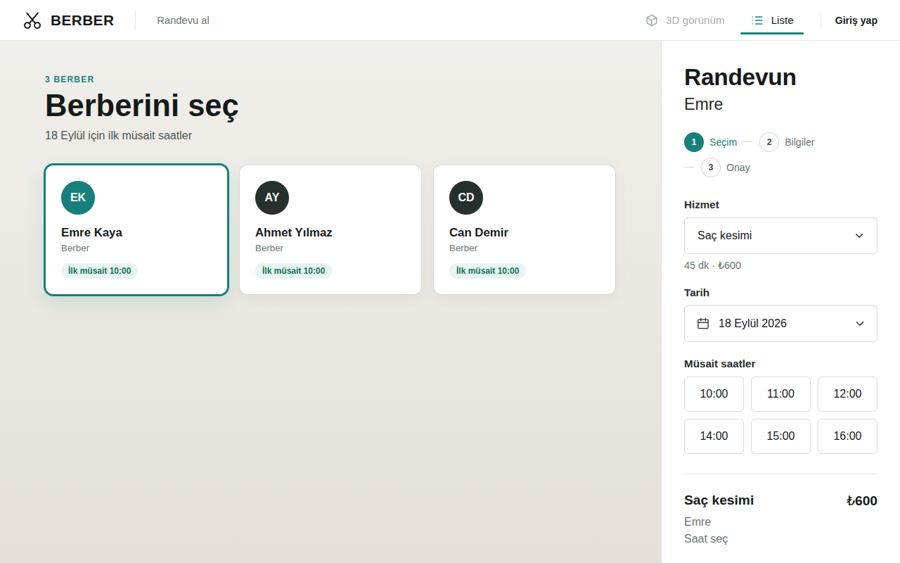
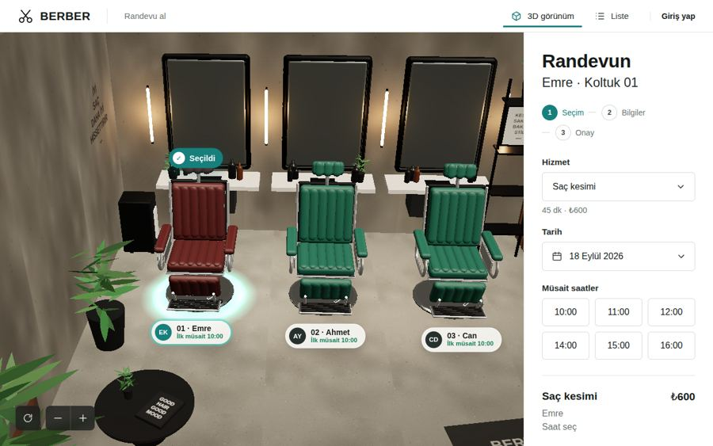
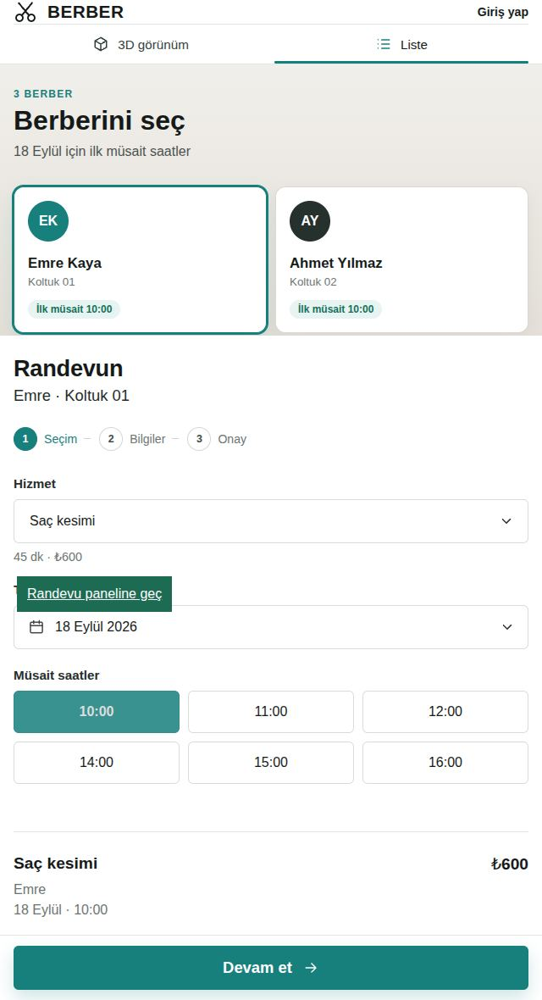
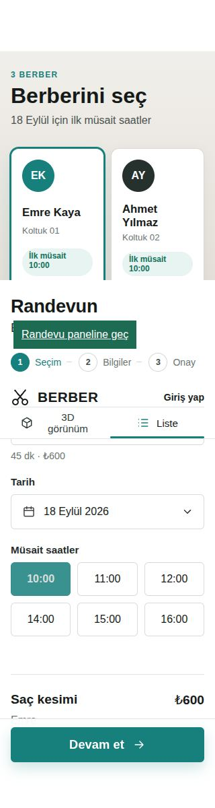

# Erişilebilirlik, zoom, düşük donanım ve 3D kill switch denetimi

**Araç:** `web/qa/phase8_audit.py` (Playwright + Chromium, üretim derlemesi, API sahte yanıtlarla)
**Tarih:** 17 Eylül 2026 · **Sonuç:** 17/17 kontrol geçti

```bash
cd web && npx vite build
python3 -m http.server --directory dist 4174   # SPA fallback'li bir statik sunucu kullanın
python3 qa/phase8_audit.py http://127.0.0.1:4174 ./qa-out
```

| Kontrol | Sonuç | Ayrıntı |
|---|---|---|
| manifest yüklenebilir ve kurulum alanları tam | ✅ Geçti | start_url=/customer/account?source=pwa |
| service worker kaydoldu ve sayfayı kontrol ediyor | ✅ Geçti |  |
| önbellekte hiçbir API/özel yanıt yok | ✅ Geçti | 12 kayıt; özel=[] |
| çevrimdışı gezinmede uygulama kabuğu/offline sayfası açılır | ✅ Geçti | MÜŞTERİ RANDEVU ALANI  Randevuların tek hesabında.  İlk ziyaretin işletme tarafı |
| çevrimdışı bandı rezervasyon panelinde görünür | ✅ Geçti |  |
| ilk Tab 'Randevu paneline geç' atlama bağlantısı | ✅ Geçti | Randevu paneline geç |
| atlama bağlantısı odağı panele taşır | ✅ Geçti | <select><option value="s1">Saç kesimi</option></select> |
| klavyeyle berber+saat+devam; adım değişince odak panel başlığında | ✅ Geçti | booking-panel-title |
| erişilebilir ad / tabindex / alt / tekrar eden id denetimi | ✅ Geçti |  |
| panel erişilebilirlik ağacı başlık, adım listesi ve düğmeleri içerir | ✅ Geçti | 13 satır |
| metin kontrastı WCAG AA | ✅ Geçti |  |
| zoom/reflow 1280x800@200%: yatay kaydırma yok, onay düğmesine ulaşılır | ✅ Geçti | taşma=0px düğme={'x': 16, 'y': 335.921875, 'width': 608, 'height': 52} |
| zoom/reflow 1920x1080@200%: yatay kaydırma yok, onay düğmesine ulaşılır | ✅ Geçti | taşma=0px düğme={'x': 643, 'y': 453.953125, 'width': 295, 'height': 60} |
| zoom/reflow 320px mobil: yatay kaydırma yok, onay düğmesine ulaşılır | ✅ Geçti | taşma=0px düğme={'x': 16, 'y': 504, 'width': 288, 'height': 52} |
| düşük donanımda low kalite ve yalnızca mobil GLB | ✅ Geçti | quality=low modeller=['barber-chair-mobile.glb'] süre=5.1s (CPU x6, yazılım GPU) |
| düşük donanımda koltuk etiketleri klavyeyle seçilebilir buton | ✅ Geçti |  |
| 3D kapalı: liste modu açılır, 3D sekmesi pasif, 3D kodu/modeli indirilmez | ✅ Geçti | indirilen=[] |

## Denetimin bulduğu ve düzeltilen sorunlar

1. **3D kill switch yarışı:** bayrak yanıtı sahne yanıtından geç gelirse 3D kodu (≈1 MB) ve model indiriliyordu. Artık 3D, bayrak cevabı gelmeden yüklenmez.
2. **Kontrast:** liste başlığındaki "ilk müsait saatler" metni gri gradyan üzerinde 2.9:1 idi → 4.5:1 üzerine çıkarıldı.
3. **Kısa ekran:** 800 px yükseklikte panelde özet satırı "Devam et" düğmesinin altına sıkışıyordu; dar panelde adım etiketi taşıyordu. Esnek öğeler küçülmez, adımlar sarılır.

## Ekran okuyucu yapısı (liste görünümü, 2. adım)

Erişilebilirlik ağacı (`qa/aria-booking-panel.txt`):

```text
- complementary "Randevun":
  - heading "Randevun" [level=1]
  - paragraph: Emre · Koltuk 01
  - list:
    - listitem: ✓ Seçim
    - listitem: 2 Bilgiler
    - listitem: 3 Onay
  - paragraph: Randevunu kaydedebilmemiz için müşteri hesabınla giriş yapman gerekiyor. Seçimlerin korunur.
  - strong: Saç kesimi
  - strong: ₺600
  - text: Emre 18 Eylül · 14:00
  - button "Geri"
  - button "Giriş yap ve devam et"
```

- 3D sahnedeki koltuk etiketleri `aria-pressed` ve "Emre Kaya, koltuk 01" adıyla gerçek düğmelerdir; canvas'a klavye gerekmez.
- "Randevu paneline geç" atlama bağlantısı 3D/liste bölümünü atlar. Adım değişince odak panel başlığına taşınır.
- Hatalar `role=alert`, durum mesajları `role=status`; çevrimdışı bandı duyurulur.
- `prefers-reduced-motion`: kamera animasyonu ve rozet animasyonu kapanır. `forced-colors`: seçim ve birincil düğme görünür kalır.

## Otomatik denetimin kapsamadıkları (pilot öncesi manuel)

- Gerçek VoiceOver (iOS/macOS) ve TalkBack/NVDA ile sesli okuma sırası ve telaffuz.
- Gerçek düşük seviye Android cihazda FPS ve pil (denetim yazılım GPU + CPU 6x yavaşlatma ile yapıldı; 3D hazır olma süresi ≈5 s).
- Tarayıcı yakınlaştırma kısayolu ile (%200) gerçek masaüstü; denetim eşdeğer CSS görünüm alanlarıyla (640×400, 960×540) yapıldı.
- Personel paneli ekranları ayrıca denetlenmedi; mevcut atlama bağlantısı ve odak yönetimi korunuyor.

## Ekranlar

| Klavye ile 2. adım | 3D kapalı → liste | Düşük donanım (low kalite) |
|---|---|---|
|  |  |  |

| %200 zoom (1280×800 ekran) | 320 px |
|---|---|
|  |  |
